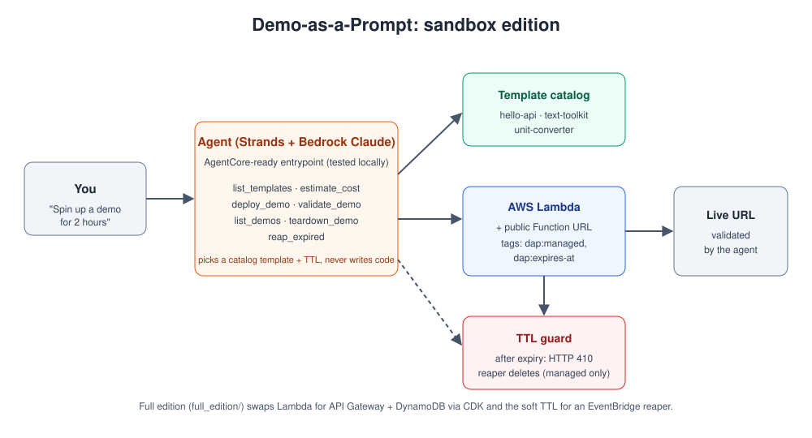

# Demo-as-a-Prompt

Ask for an AWS demo environment in plain English. A Strands agent on Amazon Bedrock deploys it from a
**vetted template**, smoke-tests it, and expired demos are cleaned up automatically.

> "Spin up a text toolkit API demo for 2 hours for a customer call, and tell me when it expires."



## Editions
| | Sandbox edition (this folder, verified live) | Full edition (`full_edition/`) |
|---|---|---|
| Demo runtime | Lambda + public Function URL (boto3) | API Gateway + Lambda + DynamoDB (CDK) |
| TTL | Soft TTL (HTTP 410 after expiry) + `reap_expired` tool, run on every deploy | EventBridge schedule + reaper Lambda |
| Needs | Lambda, IAM read, Bedrock | CloudFormation, IAM, EventBridge, Budgets |
| Status | Deployed, validated, expired and reaped in an AWS Builder Center sandbox | `cdk synth` + unit tests only, never deployed |

The sandbox edition exists because AWS Builder Center workshop sandboxes deny CloudFormation, DynamoDB,
API Gateway, EventBridge and IAM writes.

## Templates
`hello-api`, `text-toolkit` (word count, slugify, base64), `unit-converter` (temperature, length).
The model can only pick from `agent/catalog.py`; every demo gets a TTL (default 8h, max 72h).

## Safety model
- The model never writes code or infrastructure; unknown templates are rejected.
- Demos are tagged `dap:managed`, `dap:demo-id`, `dap:template`, `dap:expires-at`.
- Teardown and reaping only touch functions tagged `dap:managed=true`.

## Run it
```bash
python3 -m venv .venv && . .venv/bin/activate
pip install -r requirements.txt pytest
python -m pytest -q
export AWS_REGION=us-west-2                 # AWS credentials via your usual profile
export DAP_LAMBDA_ROLE=DemoToolLambdaRole   # an existing Lambda execution role
python -m agent.main "spin up a hello api demo for 2 hours"
```
Bedrock needs model access for `DAP_MODEL_ID` (default Claude Sonnet 4.5 via the `us.` inference profile; `DAP_BEDROCK_REGION=us-east-1`).

## AgentCore Runtime
`agentcore_app.py` is an AgentCore Runtime entrypoint. Tested locally (`python agentcore_app.py`, then POST `/invocations`
with a session-id header; session memory works). Deploying needs an account that can create S3/ECR/CodeBuild resources:
```bash
agentcore configure --entrypoint agentcore_app.py --requirements-file requirements.txt
agentcore deploy
```
This repo has **not** been deployed to AgentCore Runtime.

## Known limits
- Soft TTL: an expired demo stops answering immediately but is only deleted on the next deploy or `reap_expired` call.
- Function URLs are public (`AuthType NONE`); templates are stateless on purpose.
- The public Function URL needs two permissions; the AWS CLI lacks a flag for the second, so this uses boto3.

## Blog
Draft: `docs/medium-post-draft.md`.
